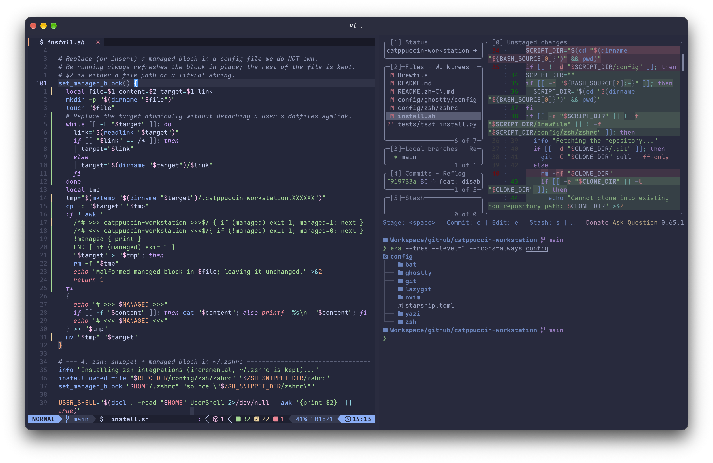

# Catppuccin Workstation

[中文文档](README.zh-CN.md)

A macOS terminal workstation dressed in one theme — [Catppuccin Macchiato](https://catppuccin.com) — from the terminal emulator down to the file manager.

<!-- TODO: replace with a real terminal screenshot -->


## What's inside

| Layer | Tool | Notes |
| --- | --- | --- |
| Terminal | [Ghostty](https://ghostty.org) | Catppuccin Macchiato, subtle blur, hot reload on `cmd+shift+r` |
| Prompt | [starship](https://starship.rs) | Minimal format: directory, git branch, host (SSH only) |
| Shell | zsh | [zsh-autosuggestions](https://github.com/zsh-users/zsh-autosuggestions), [zsh-syntax-highlighting](https://github.com/zsh-users/zsh-syntax-highlighting), [fzf](https://github.com/junegunn/fzf), [fzf-tab](https://github.com/Aloxaf/fzf-tab), [zoxide](https://github.com/ajeetdsouza/zoxide) — no Oh My Zsh |
| CLI replacements | [eza](https://github.com/eza-community/eza) / [bat](https://github.com/sharkdp/bat) / [ripgrep](https://github.com/BurntSushi/ripgrep) / zoxide | `ls`, `cat`, `grep`, `cd` upgrades |
| Git | [delta](https://github.com/dandavison/delta) + [lazygit](https://github.com/jesseduffield/lazygit) | Themed diffs everywhere; lazygit renders diffs through delta |
| Editor | [Neovim](https://neovim.io) + [LazyVim](https://www.lazyvim.org) | Stock LazyVim + the Catppuccin colorscheme |
| Files | [yazi](https://github.com/sxyazi/yazi) | Catppuccin flavor, `y()` cds to the browsed directory on quit |

Fonts: [Maple Mono NF](https://font.subf.dev/en/) (installed via Homebrew) + [Source Han Sans SC](https://github.com/adobe-fonts/source-han-sans) (vendored under `fonts/`, SIL OFL 1.1).

## Install

One line:

```bash
curl -fsSL https://raw.githubusercontent.com/barrychen38/catppuccin-workstation/main/install.sh | bash
```

Or clone and inspect first:

```bash
git clone https://github.com/barrychen38/catppuccin-workstation
cd catppuccin-workstation && ./install.sh
```

Everything is **incremental** — nothing of yours gets thrown away:

- `~/.zshrc` keeps its content; a small managed block is appended that sources our snippet from `~/.config/catppuccin-workstation/zshrc`
- `~/.gitconfig` keeps its content; delta settings are merged in with `git config --global`
- Ghostty gets a managed block appended to its config (later lines win)
- bat config only gains the theme lines if missing
- Files we fully own (starship.toml, lazygit, nvim, yazi flavor) are backed up to `~/.dotfiles-backup/<timestamp>/` before being replaced
- The installer also installs dependencies via Homebrew (`--no-brew` to skip), the Source Han Sans font, Catppuccin themes for bat, and bootstraps Neovim plugins headlessly

The setup targets zsh (the macOS default). If your login shell is something else, the installer will tell you how to switch (`chsh -s /bin/zsh`).

## Tools & links

- Theme: [Catppuccin](https://catppuccin.com) · [catppuccin/delta](https://github.com/catppuccin/delta) · [catppuccin/bat](https://github.com/catppuccin/bat) · [catppuccin/yazi](https://github.com/catppuccin/yazi)
- Terminal: [Ghostty](https://ghostty.org)
- Prompt & shell: [starship](https://starship.rs) · [zsh-autosuggestions](https://github.com/zsh-users/zsh-autosuggestions) · [zsh-syntax-highlighting](https://github.com/zsh-users/zsh-syntax-highlighting) · [fzf](https://github.com/junegunn/fzf) · [fzf-tab](https://github.com/Aloxaf/fzf-tab) · [zoxide](https://github.com/ajeetdsouza/zoxide)
- CLI: [eza](https://github.com/eza-community/eza) · [bat](https://github.com/sharkdp/bat) · [ripgrep](https://github.com/BurntSushi/ripgrep)
- Git: [git-delta](https://github.com/dandavison/delta) · [lazygit](https://github.com/jesseduffield/lazygit)
- Editor: [Neovim](https://neovim.io) · [LazyVim](https://www.lazyvim.org)
- Files: [yazi](https://github.com/sxyazi/yazi)
- Fonts: [Maple Mono](https://font.subf.dev/en/) · [Source Han Sans](https://github.com/adobe-fonts/source-han-sans)

## Rollback

Replaced files are moved to `~/.dotfiles-backup/<timestamp>/`. The zsh and gitconfig changes can be undone by deleting the `# >>> catppuccin-workstation >>>` block from `~/.zshrc` and unsetting the delta keys.

## License

MIT for everything in this repository, except `fonts/SourceHanSansSC-VF.ttf` which is distributed under the SIL Open Font License 1.1 (see `fonts/OFL.txt`).
